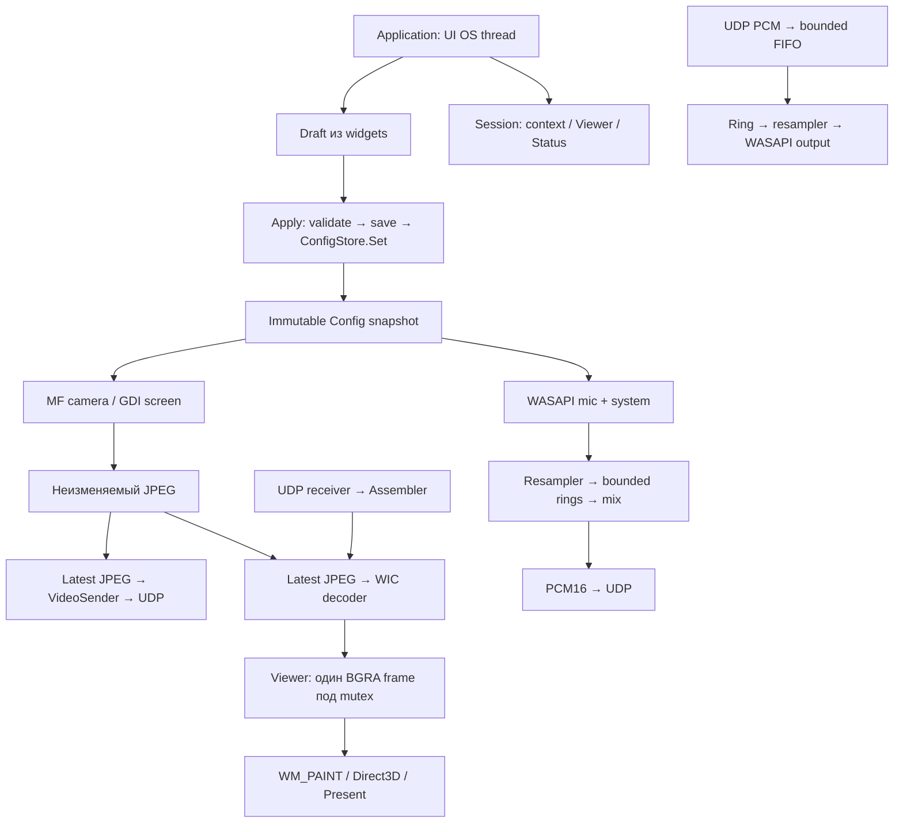

# Архитектура и потоки данных

## Две реализации

Python 4.3 состоит из Tk-панели и отдельных дочерних процессов камеры и экрана/звука.
Они общаются с панелью через аутентифицированный localhost JSON control plane.
Go 5.0 содержит панель, два окна, сетевые и аппаратные workers **в одном процессе**.
Горутины выполняют работы независимо, но fatal runtime error завершает все окна.
Одинаковый UDP media format позволяет обновлять передатчик и приёмник по отдельности.

## Карта Go

Все управляющие изменения начинаются в UI. Рабочие циклы не читают свойства
Walk-виджетов и не меняют их. Они читают `ConfigStore.Get`, публикуют короткий
`Status` и передают данные через bounded containers.

## Роли

| Роль | Камера/экран | Звук | Сеть |
|---|---|---|---|
| server | Нативный захват, локальный preview | Mic/system mix | Слушает SUB и отправляет медиа |
| client | Приём JPEG и локальная обработка | PCM → выбранные динамики | Эфемерные порты, SUB раз в секунду |
| local | Захват и локальный preview | Захват без воспроизведения | Медиа в LAN не отправляется |

`preview=false` и свёрнутое окно пропускают **декодирование локального просмотра**.
Сетевой приём, захват и передача продолжаются. Пауза захвата экрана — отдельное поле.
`video_enabled=false` не выключает звук, если `audio_enabled=true`.

## Границы потоков

| Компонент | Владелец | Что можно передавать наружу |
|---|---|---|
| Application, Walk, D3D device | Main OS thread, закреплённый `LockOSThread` | Status/неизменяемый Config |
| MF capture | Собственная COM-горутинa/OS thread | Копию JPEG |
| GDI capture + WIC encode | Собственная COM-горутинa/OS thread | Копию JPEG |
| WIC decode | Отдельный COM worker каждого Viewer | PixelFrame с передачей владения |
| WASAPI source/output | Собственный COM worker | Go float32 через ring |
| UDP sender/receiver | Сетевые горутины | Неизменяемые байты / AudioPacket |

`LockOSThread` не превращает COM-указатели в thread-safe. Здесь объект создаётся,
используется и освобождается в своём worker. Нельзя перенести interface pointer
на произвольную горутину и считать, что наличие mutex решило COM apartment rules.

## Владение и время жизни

1. MF/WASAPI buffers заимствуются до Unlock/ReleaseBuffer; наружу уходят копии.
2. JPEG `[]byte` после публикации считается неизменяемым. Один срез может читаться
   preview и sender, потому что оба не меняют его содержимое.
3. WIC создаёт Go BGRA buffer. `Viewer.Publish` принимает его целиком; producer
   перестаёт пользоваться `Pixels`. Viewer освобождает старый buffer ровно один раз.
4. `Viewer.mu` удерживается при смене кадра и загрузке текстуры, предотвращая возврат
   в pool во время чтения. После upload GPU читает свою текстуру, а не Go-срез.
5. `sync.Pool` — cache выделений. Он может очиститься при GC и не ограничивает RAM.
6. Каждый COM reference имеет `Release`, GDI handle — соответствующее освобождение.
   Сборщик мусора Go не заменяет ни то, ни другое.

## Очереди и задержка

Видео использует freshness policy: один свежий JPEG, один готовый BGRA frame,
коалесцируемая WM_PAINT. Отставание не должно превращаться в историю воспроизведения.
Неполный JPEG ограничен числом частей, кадров и сроком хранения.

Звуку нужна последовательность. Здесь используются FIFO на 64 пакета и rings
фиксированного размера. Нехватка дополняется нулями, избыток удаляется с начала.
Ограниченность памяти сама по себе не гарантирует малую задержку: число сэмплов,
частота, channels, endpoint buffering и возраст сетевого пакета также важны.

Протокол не несёт времени захвата и не синхронизирует часы. Камера, экран и звук
не имеют общего timestamp timeline и гарантированной синхронизации A/V.

## Apply и остановка

`draft()` копирует Config и собирает поля widgets. `apply()` валидирует, сохраняет
профиль, публикует snapshot и при необходимости перезапускает затронутый Session.
GPU-параметры/уровни звука читаются live; формат, host и устройства обычно требуют restart.
Apply не является общей транзакцией: ошибка устройства после записи профиля не откатывает
остальные рабочие компоненты автоматически.

Stop отменяет context и закрывает Viewer, не блокируя UI до завершения всех workers.
UDP пробуждается закрытием socket/deadline; синхронный MF ReadSample может задержать выход.
Retry источника через секунду смягчает гонку освобождения устройства при restart,
но полноценного join/watchdog для зависшего драйвера в этой версии нет.
